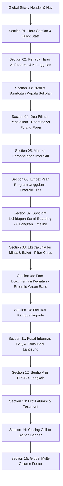

# DESIGN SYSTEM & UI SPECIFICATION
# SMP IT Al-Firdaus Samarinda — Modern Islamic Academic (Emerald Green Theme)

> Dokumen spesifikasi desain antarmuka, hierarki komponen, layout grid, dan sistem token UI yang diperbarui berdasarkan desain **Stitch MCP** dengan nuansa **Emerald Green** (`#107C41`) dan penyederhanaan pusat informasi FAQ langsung ke konseling WhatsApp resmi.

---

## 1. Ringkasan Eksekutif & Filosofi Desain

### 1.1 Brand Identity & Tone
Website **SMP IT Al-Firdaus Samarinda** (*"The Real School for Qur'anic Generation"*) mengusung filosofi **Modern Islamic Academic**:
- **Aspirational yet Grounded**: Menampilkan pendidikan Islam terpadu yang progresif, berwawasan global, dan berakar pada kemuliaan adab kesantrian (*Al-Adab Qablal 'Ilm*).
- **Clear & Transparent**: Membantu calon wali murid dan santri membuat keputusan besar secara objektif dalam memilih dua jalur pendidikan setara: **Boarding School (Asrama Khusus Ikhwan)** atau **Full Day School (Pulang-Pergi)**.
- **Emerald Green Visual Language**: Menggunakan kanvas putih bersih (*pure white canvas*), tipografi kontras tinggi (*Outfit*), aksen utama **Emerald Green** (`#107C41`), sentuhan permukaan lembut mint (`#E8F5EE`), serta elemen membulat (*pill-shaped controls* & rounded containers).

---

## 2. Design Tokens & Design System

### 2.1 Palet Warna (Color Palette)

| Kategori Token | Nama Token | Nilai Hex | Peran & Penggunaan UI |
| :--- | :--- | :--- | :--- |
| **Primary Brand** | `primary` | `#107C41` | Warna utama: Tombol CTA primer, teks penekanan (highlight title), active navbar, pilar tiles, dan badge penting. |
| **Primary Hover** | `primary-hover` | `#094C27` | State hover dan active pada tombol primer dan tautan interaktif. |
| **Primary Soft / Tint** | `primary-soft` | `#E8F5EE` | Latar belakang chip aktif, badge ikon, dan sorotan lembut. |
| **Primary Deep** | `primary-deep` | `#0F764E` | Latar belakang pita seksi galeri dokumentasi foto. |
| **Surface Canvas** | `surface` | `#FFFFFF` | Latar utama halaman dan permukaan kartu (card rest state). |
| **Surface Dim** | `surface-dim` | `#DBDAD9` | Pemisah tonal dan border netral sekunder. |
| **Surface Bright** | `surface-bright` | `#FBF9F9` | Latar kontras halus untuk transisi section. |
| **Surface Tint** | `surface-tint` | `#E8F5EE` | Pita section sekunder (ekstrakurikuler, FAQ chip, icon container). |
| **Surface Container Low** | `surface-container-low` | `#F5F3F3` | Latar kartu jadwal, alur PPDB, dan ribbon quick-stats. |
| **Surface Container** | `surface-container` | `#EFEDED` | Container placeholder media dan form input rest state. |
| **Text Primary** | `text-primary` | `#292929` | Warna teks utama untuk judul headline display dan body copy tebal. |
| **Text Secondary** | `text-secondary` | `#5F5E5E` | Deskripsi pendukung, paragraf isi, dan sub-judul. |
| **Text Muted** | `text-muted` | `#8E8D8D` | Teks keterangan kecil, metadata, timestamp, dan footer fine-print. |
| **Border Subtle** | `border-subtle` | `#ECECEC` | Garis batas tipis 1px pada kartu, navbar divider, dan list item. |
| **Border Strong** | `border-strong` | `#DCDCDC` | Garis batas form input, toggle switch, dan tabel matriks. |
| **Accent Gold** | `warm-gold` | `#F2B84B` | Rating bintang testimoni, lencana prestasi, dan medali penghargaan. |
| **Success / Validation** | `success-green` | `#107C41` | Ikon checklist fitur unggulan, status aktif, dan verifikasi PPDB. |

---

### 2.2 Tipografi (Typography Scale)

Sistem tipografi menggunakan **Outfit** (dengan alternatif sans-serif modern seperti *Poppins* atau *Inter*):

```css
/* Typography Scale Tokens */
--font-family-base: 'Outfit', -apple-system, BlinkMacSystemFont, 'Segoe UI', Roboto, sans-serif;
```

| Token Level | Ukuran Font | Line Height | Weight | Letter Spacing | Penggunaan |
| :--- | :--- | :--- | :--- | :--- | :--- |
| `display` | `48px` (`3rem`) | `1.12` | 700 (Bold) | `-0.03em` | Headline utama Hero Section Desktop |
| `display-mobile`| `32px` (`2.125rem`)| `1.20` | 700 (Bold) | `-0.02em` | Headline utama Hero Section Mobile |
| `headline-lg` | `38px` (`2.375rem`)| `1.18` | 700 (Bold) | `-0.025em`| Judul section utama (Section Titles) |
| `headline-md` | `24px` (`1.5rem`) | `1.25` | 700 (Bold) | `-0.015em`| Judul kartu program, tabel header |
| `headline-sm` | `18px` (`1.125rem`)| `1.30` | 600 (Semibold)| `-0.01em` | Judul sub-kartu, feature cards, nama modul |
| `body-lg` | `17px` (`1.0625rem`)| `1.65` | 400 (Regular) | Normal | Paragraf pengantar, lead text, hero description |
| `body-md` | `15px` (`0.9375rem`)| `1.60` | 400 (Regular) | Normal | Body text umum, kartu keuntungan, deskripsi |
| `body-sm` | `13px` (`0.8125rem`)| `1.50` | 400 (Regular) | Normal | Caption, catatan kaki, rincian jadwal harian |
| `label-md` | `13px` (`0.8125rem`)| `1.40` | 600 (Semibold)| `+0.02em` | Label tombol aksi, navigasi bar, menu teks |
| `label-sm` | `11px` (`0.6875rem`)| `1.40` | 600 (Semibold)| `+0.04em` | Kicker tag, badge status, step counter |

---

### 2.3 Sistem Ruang, Grid, & Layout (Spacing & Grid)

```
Max Container Width: 1240px (Centered)
Desktop Canvas Margin: 7vw (~80px - 110px)
Mobile Canvas Margin: 1.25rem (20px)
Vertical Section Spacing (Desktop): 5.5rem (88px)
Vertical Section Spacing (Mobile): 3.5rem (56px)
Grid Column Gap: 1.5rem (24px)
```

---

### 2.4 Sistem Radius & Bentuk (Shapes & Radii)

| Token Radius | Nilai | Implementasi Komponen |
| :--- | :--- | :--- |
| `rounded-pill` | `9999px` | Tombol CTA primer/sekunder, filter chips, badge status. |
| `rounded-3xl` | `24px` – `32px` | Hero image frame, kartu program belajar, banner penutup CTA. |
| `rounded-2xl` | `16px` | Kartu keunggulan, kartu fasilitas, jadwal harian, accordion FAQ. |
| `rounded-xl` | `12px` | Container ikon, thumbnail galeri, baris tabel matriks. |
| `rounded-lg` | `8px` – `10px` | Input form PPDB, status badge ringkas. |

---

## 3. Komponen UI Standar (UI Component Library)

### 3.1 Tombol (Buttons)
1. **Button Primary (`.btn-primary`)**:
   - Bentuk: Pill (`rounded-full` / `9999px`).
   - Warna: Background `#107C41`, teks `#FFFFFF`, font Semibold.
   - Dimensi: Min-height `46px` (memenuhi standar aksesibilitas sentuhan).
   - State Hover: Berubah ke `#094C27` dengan bayangan `box-shadow: 0 6px 20px rgba(16, 124, 65, 0.4)`.
2. **Button Secondary (`.btn-secondary`)**:
   - Bentuk: Pill (`rounded-full`).
   - Warna: Background `#FFFFFF`, border `#DCDCDC`, teks `#292929`.
   - State Hover: Background `#E8F5EE`, border & teks `#107C41`.
3. **Button Outline (`.btn-outline`)**:
   - Border `1.5px solid #107C41`, teks `#107C41`, hover ke solid `#107C41` dengan teks putih.

---

### 3.2 Kartu Informasi (Cards Architecture)
1. **Advantage Card**: Permukaan putih `#FFFFFF`, border `1px solid #ECECEC`, ikon di dalam container membulat `#E8F5EE` beraksen hijau `#107C41`.
2. **Program Card (Boarding vs Pulang-Pergi)**: 2 kolom seimbang (6:6), checkmark hijau `#107C41`, CTA tombol pill di bawah kartu.
3. **Pillar Tile**: Latar Emerald Green `#107C41` solid dengan teks kontras tinggi `#FFFFFF`, ikon transparan `bg-white/20`.
4. **Daily Routine Card**: Penunjuk jam tebal di atas (`03.30 – 05.30`), label aktivitas, deskripsi nilai spiritual, dan ikon waktu di sudut bawah.

---

### 3.3 Pusat Informasi FAQ & Konsultasi Langsung
1. **FAQ Accordion (`<details>` / `<summary>`)**:
   - Kontainer terpisah dengan nomor urut bulat (`01`, `02`, dst.) berlatar `#E8F5EE`.
   - Ikon panah berputar 180 derajat saat panel terbuka (`rotate(180deg)`).
2. **Direct Counselor Banner (Pengganti AI Assistant)**:
   - Banner horizontal di bawah FAQ dengan ikon agen konselor berlatar `#E8F5EE`, heading komunikatif, dan tombol aksi WhatsApp langsung: *"Konsultasi via WhatsApp"*.

---

## 4. Hierarki Struktur & Layout Halaman (Page Structure)



---

## 5. Standar Aksesibilitas & Kualitas Teknis

1. **Rasio Kontras WCAG AA**:
   - Teks `#292929` di atas kanvas putih `#FFFFFF` (14.8:1 - Lolos AAA).
   - Teks putih `#FFFFFF` di atas tombol `#107C41` (4.6:1 - Lolos standar AA).
2. **Keyboard Navigability**:
   - Seluruh kontrol tombol, tab, modal, dan tautan memiliki status `:focus-visible` berupa ring fokus hijau terpadu (`outline: 2px solid #107C41; outline-offset: 3px`).
3. **Responsivitas**:
   - Desktop ($\ge$ 1024px): 2 kolom split (Hero 7:5, Profil 5:7, Program 6:6), 4 kolom kartu keunggulan & pilar.
   - Tablet (768px – 1023px): Grid 2 kolom seimbang, padding horizontal 2rem.
   - Mobile (< 768px): 1 kolom vertikal rapi, mobile drawer menu dengan touch targets minimal `44px`.
